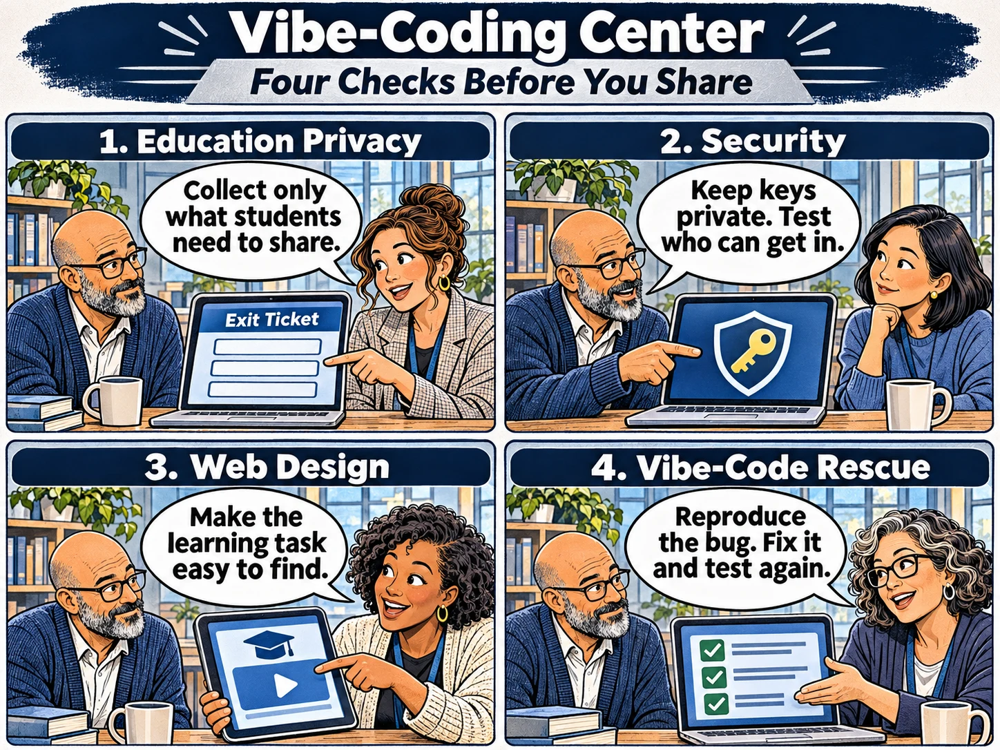

# Before you share with a class

These reminders help organize your review. Ticking a box is not evidence that a site is safe or approved.

## Four checks before you share

[Open the full-size Four Checks cartoon](../assets/cartoons/four-checks.png) · [Download the Four Checks PNG](../assets/cartoons/four-checks.png) · [View the original Three Essential Checks cartoon](../assets/cartoons/three-essential-checks.png)

### The cartoon in text

1. **Education privacy.** A woman points to an anonymous exit ticket and says, “Collect only what students need to share.” Use [Education Privacy](../guides/education.html) to decide what to collect and map where it goes.
2. **Security.** A bald, bearded man points to a laptop with a shield and key and says, “Keep keys private. Test who can get in.” Use [Security](../guides/security.html) to review secrets and test access boundaries.
3. **Web design.** A woman shows a simple classroom activity and says, “Make the learning task easy to find.” Use [Web Design](../guides/design.html) to organize the page around what learners need to do.
4. **Vibe-Code Rescue.** A woman demonstrates a repair with a laptop and checklist and says, “Reproduce the bug. Fix it and test again.” Use [Vibe-Code Rescue](../guides/rescue.html) to record what fails, isolate the cause, and verify the repair.

## Try the classroom journey

- [ ] The learning task works with invented data
- [ ] I can finish the task using only a keyboard
- [ ] Text and controls work on a phone and at high zoom
- [ ] No private keys or passwords reach the browser
- [ ] I know what is stored, sent, shared, and deleted
- [ ] Student-data questions have a school decision owner

Selections stay in this page's memory and reset when you reload. Nothing is saved or submitted by these reminders.

## Keep the evidence

Use [the launch review template](../templates/LAUNCH_REVIEW.md) to record what passed, what failed, which checks were not run, and who must resolve school or vendor decisions. [Read the launch review guide](../guides/launch.html) for the complete record.

Keep the full instructions for all four guides nearby. They explain the checks behind these reminders.
