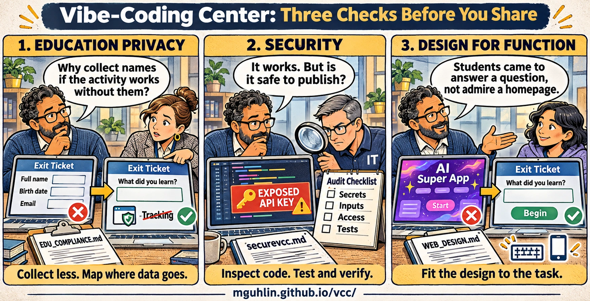

# Before you share with a class

These reminders help organize your review. Ticking a box is not evidence that a site is safe or approved.

## Three checks before you share

[Open full-size Three Essential Checks cartoon](../assets/cartoons/three-essential-checks.png) · [Download original Three Essential Checks PNG](../assets/cartoons/three-essential-checks.png)

### The cartoon in text

1. **Education privacy:** “Why collect names if the activity works without them?” An exit ticket asking for a full name, birth date, and email becomes a simpler learning question. Collect less and map where data goes. Use `EDU_COMPLIANCE.md`.
2. **Security:** “It works. But is it safe to publish?” An educator and an IT colleague investigate an exposed API key and review secrets, inputs, access, and tests. Inspect code, test, and verify with `securevcc.md`.
3. **Design for function:** “Students came to answer a question, not admire a homepage.” A distracting AI-themed start screen becomes a clear exit-ticket activity. Fit the design to the task with `WEB_DESIGN.md`.

## Try the classroom journey

- [ ] The learning task works with invented data
- [ ] I can finish the task using only a keyboard
- [ ] Text and controls work on a phone and at high zoom
- [ ] No private keys or passwords reach the browser
- [ ] I know what is stored, sent, shared, and deleted
- [ ] Student-data questions have a school decision owner

Selections stay in this page's memory and reset when you reload. Nothing is saved or submitted by these reminders.

## Keep the evidence

Use [the launch review template](../templates/LAUNCH_REVIEW.md) to record what passed, what failed, which checks were not run, and who must resolve school or vendor decisions. [Read the launch review guide](../guides/launch.html) for the complete record.

Keep the full [web design](../guides/design.html), [security](../guides/security.html), and [education privacy](../guides/education.html) instructions nearby. They explain the checks behind these reminders.
